<p align="center">
  
</p>

<p align="center">
  <a href="GmapsXploit.sh"></a>
  
  
  
  <a href="LICENSE"></a>
  <a href="https://github.com/DeathShotXD/GmapsXploit/stargazers"></a>
</p>

<p align="center">
  <strong>One exposed key. Thirty-one endpoints. One bill.</strong><br>
  Map what a Google API key can reach, then price the exposure.
</p>

GmapsXploit audits exposed or unrestricted Google API keys and turns them into
high-impact findings. It tests a key against Google Maps, Places, Roads, the
newer Routes and Aerial View endpoints, and several Cloud services, then shows
the real risk: what the key can reach and what it costs. Instead of a low
severity note, you get a clear impact and a ready-to-submit report.

<p align="center">
  
</p>

## What is GmapsXploit?

<p align="center">
  
</p>

A single Bash script for bug bounty hunters, penetration testers, and
researchers who find Google API keys in web apps, mobile apps, or extensions.
It probes the key across thirty-one endpoints, detects restrictions such as IP
or referer limits, estimates billing impact from request volume, and writes a
Markdown report suitable for a program.

<p align="center">
  
</p>

<br>

> An exposed Google API key is not a low finding when it is unrestricted and
> bills someone else's account.

<br>

<p align="center">
  
</p>

## Why this matters

Unrestricted Google API keys, especially with Places or the advanced APIs
enabled, allow anyone to run up a bill on the owner's account. There are public
cases where costs reached tens of thousands of dollars in a short time.
GmapsXploit shows that impact with real numbers and a working proof.

The tool does not stop at "the key works." It separates a live key from an
exploitable one, records the restrictions it can observe, and converts the
reachable endpoints into a per-100,000-request estimate using published
pricing.

<p align="center">
  
</p>

## Coverage

| Surface | Endpoints | Tested |
|---------|:---------:|--------|
| Maps | 7 | Static Maps, Street View, Geocoding, Directions, Distance Matrix, Elevation, Timezone |
| Places | 7 | Find Place, Autocomplete, Place Details, Nearby Search, Text Search, Place Photo, Places Aggregate |
| Roads | 3 | Nearest Roads, Snap to Roads, Speed Limits |
| Gemini | 4 | Generate Content, List Models, Files, Cached Contents |
| Cloud | 6 | Cloud Vision, Translation, Custom Search, Geolocation, Firebase Dynamic Links, Address Validation |
| New APIs | 4 | Compute Routes, Aerial View, Air Quality, Pollen |

## Features

- Tests thirty-one Google Cloud endpoints in one pass.
- Calculates financial impact per 100,000 requests from published pricing.
- Detects key restrictions such as IP or referer limits.
- Generates both a technical report and a submission-ready Markdown report.
- Optional billing simulation against the endpoints that accepted the key.
- Clean terminal output with no external dependencies.

## Installation

```bash
git clone https://github.com/DeathShotXD/GmapsXploit.git
cd GmapsXploit
chmod +x GmapsXploit.sh
./GmapsXploit.sh
```

Bash 4.0 or later. No external dependencies.

## Usage

```bash
./GmapsXploit.sh
```

1. Enter the target Google API key.
2. Watch the reconnaissance phase.
3. Review the financial impact results.
4. Use the generated report for submission.

### Options

| Option | Description |
|--------|-------------|
| `-k, --key KEY` | API key to audit (prompted if omitted) |
| `-o, --out DIR` | Output directory (default: `.`) |
| `-t, --timeout SEC` | Request timeout (default: `10`) |
| `-s, --simulate` | Opt-in billing simulation against vulnerable endpoints |
| `-n, --count N` | Requests per endpoint for the simulation (default: `1000`) |
| `--no-color` | Disable colored output |
| `-q, --quiet` | Suppress informational output |
| `-v, --version` | Print the version and exit |
| `-h, --help` | Show help |

Pass the key directly when scripting:

```bash
./GmapsXploit.sh --key AIza... --out reports/
```

## Output

Each run writes two files:

- `gmapsxploit_report_*.txt` - the full technical detail.
- `bounty_report_*.md` - a submission-ready report.

## Example

<p align="center">
  
</p>

In the included sample run, seven of the thirty-one endpoints accepted the
key. At 100,000 requests per endpoint, the published pricing works out to
**$8,383**.

| Endpoint tested | Status |
|-----------------|--------|
| Geocoding | VULNERABLE |
| Directions | VULNERABLE |
| Find Place | VULNERABLE |
| Autocomplete | VULNERABLE |
| Place Details | VULNERABLE |
| Text Search | VULNERABLE |
| Compute Routes | VULNERABLE |

A sample report is in
[examples/gmapsxploit_report_sample.txt](examples/gmapsxploit_report_sample.txt).

## Detection and defensive guidance

Indicators of exposure to look for:

- API keys present in client-side code, bundles, or app packages.
- Requests to Google API hosts from unexpected sources.
- Billing spikes without a matching deployment.

Mitigations:

- Restrict every key by application, IP, referer, or API.
- Keep keys server-side and out of client bundles.
- Enable budget alerts and quotas per key.
- Rotate any key that has been public.

## Repository structure

```
GmapsXploit/
|-- GmapsXploit.sh
|-- report_template.md
|-- README.md
|-- LICENSE
|-- SECURITY.md
|-- CHANGELOG.md
|-- CONTRIBUTING.md
|-- PLAN.md
|-- logo.png
|-- demo.png
|-- assets/
|   |-- hero.svg
|   |-- coverage.svg
|   +-- divider.svg
|-- examples/
|   +-- gmapsxploit_report_sample.txt
+-- tests/
    +-- smoke.sh
```

## Limitations

- Impact is estimated from published pricing and request volume; Google may
  cap or bill differently.
- A restricted key can still be valid; the tool reports the restriction.
- Coverage tracks the public endpoints at the time of release.

## Responsible use

GmapsXploit is built for authorized security testing. Run it only against keys
and accounts you own or have explicit permission to test. Using it against
systems without authorization may violate law.

## Credits

Author: D34thSh0tX_X (github.com/DeathShotXD).

## License

MIT. See [LICENSE](LICENSE).
